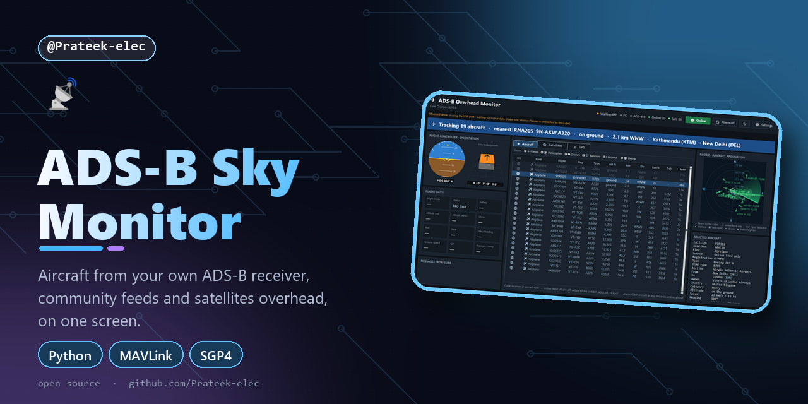
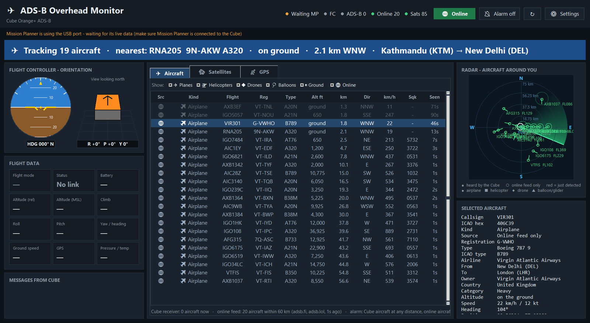
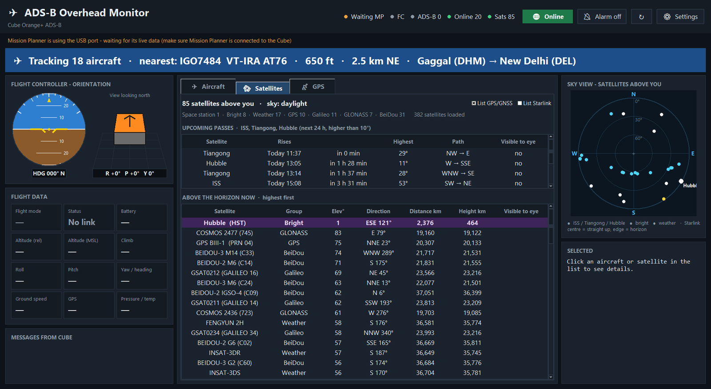
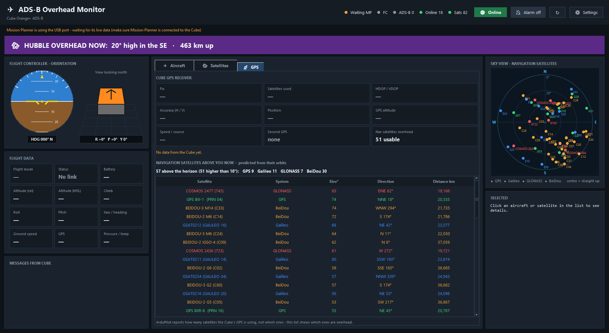

<div align="center">



**See everything flying over your head on one screen: aircraft from your own ADS-B receiver, aircraft from community networks, and satellites.**

A Windows desktop app that turns a **Cube Orange+** flight controller with its built-in ADS-B receiver into a sky monitor. It shows live flight-controller telemetry, lists and plots every aircraft the Cube hears, fills the gaps with free online ADS-B feeds, and predicts satellite passes with SGP4. Different alarm tunes play for planes, helicopters, drones, balloons, emergency squawks and the ISS.


</div>

---


<sub><b>Aircraft tab:</b> the live aircraft table, a radar around your location, and the flight controller's attitude and telemetry on the left. This demo uses the online feed with the location set to Delhi.</sub>

## Highlights

- 📡 **Your own receiver comes first.** The app reads `ADSB_VEHICLE` messages straight from the Cube over USB. It doesn't need Mission Planner, and it reconnects on its own.
- 🌐 **The internet fills the gaps.** It merges in aircraft from [adsb.fi](https://adsb.fi) and [adsb.lol](https://adsb.lol) that your antenna can't hear, and marks each one so you always know the source.
- 🔎 **Find out who's flying.** Click an aircraft to look up its registration, type, owner, airline and route on [adsbdb](https://www.adsbdb.com).
- 🛰️ **Satellites too.** The ISS, Tiangong, Hubble, bright and weather satellites, Starlink, and the GPS, Galileo, GLONASS and BeiDou constellations, predicted from CelesTrak orbits, with a sky plot and 24-hour pass predictions.
- 🔔 **Alarms you can tell apart by ear.** Each kind of detection has its own tune, and emergency squawks (7500, 7600, 7700) take priority. Alarms can keep sounding until you press STOP, and they play on any speaker, Bluetooth included.
- 🤝 **Works alongside Mission Planner.** The app re-shares the Cube to Mission Planner over UDP 14550. If Mission Planner already holds the USB port, the app reads Mission Planner's live telemetry log instead.
- 📝 **Logs everything.** Every ADS-B report goes to a daily CSV file. Connection changes and detections go to a daily event log.

## What you see

| Area | What it shows |
|---|---|
| **Status bar** | Link state, flight controller, ADS-B count, internet and satellite status, plus buttons for online / offline, alarm mute, reconnect and settings |
| **Banner** | The newest or most important detection, with a big **STOP ALARM** button while an alarm keeps sounding |
| **Flight controller** | An artificial horizon and a 3D orientation view, plus flight mode, armed state, battery, relative and MSL altitude, climb rate, roll / pitch / yaw, ground speed, GPS, and pressure / temperature |
| **Aircraft tab** | One row per aircraft: source (Cube or online), kind, callsign, registration, type, altitude, distance, bearing, speed, squawk and last seen. You can filter by planes, helicopters, drones, balloons, ground vehicles and online-only aircraft |
| **Radar** | Aircraft around you, with automatic range and a sweep. Filled markers were heard by the Cube, hollow ones come from the online feed, and red ones were just detected |
| **Satellites tab** | Upcoming ISS, Tiangong and Hubble passes (next 24 h, above 10°) and everything above the horizon now, highest first. The right-hand panel becomes a sky plot |
| **GPS tab** | The Cube's GPS receiver (fix type, satellites used, HDOP / VDOP, accuracy, position, second GPS) next to the navigation satellites predicted to be overhead |
| **Selected** | Full details for the aircraft or satellite you click, including the online lookup |

<table>
<tr>
<td width="50%"><br/><sub><b>Satellites tab:</b> upcoming ISS / Tiangong / Hubble passes, everything above the horizon, and the sky plot</sub></td>
<td width="50%"><br/><sub><b>GPS tab:</b> the Cube's GPS receiver next to the GPS, Galileo, GLONASS and BeiDou satellites predicted overhead</sub></td>
</tr>
</table>

## How it works

```text
 Cube Orange+ ──USB (MAVLink 2)──► Link thread ─────────┐
   ADSB_VEHICLE, ATTITUDE, VFR_HUD, GPS_RAW_INT, ...    │
   └──► UDP relay :14550 ──► Mission Planner            │
                                                        ▼
 adsb.fi + adsb.lol ──► OnlineFeed (every 10 s) ───► queue ──► Tk GUI ──► table · radar · sky plot
 adsbdb.com         ──► OnlineLookup (on click) ───►   │           └────► alarm tunes · CSV + event logs
 CelesTrak TLEs     ──► SatTracker (SGP4, 12 h cache) ─┘
```

- **Connection** (`Link`): the app finds the Cube by its USB vendor ID (`0x2DAE`, CubePilot), skips the SLCAN port, and requests the data streams it needs. If Mission Planner is holding the port, the app follows Mission Planner's newest `.tlog` (`TlogTail`) and its MAVLink Mirror on UDP instead.
- **Aircraft kinds** come from the ADS-B emitter category. Rotorcraft count as helicopters and UAVs as drones. Gliders, balloons, parachutes and ultralights count as balloons. Emergency vehicles, service vehicles and obstacles count as ground. Everything else is a plane.
- **Online feed** (`online_feed.py`): queries both networks around your location and merges the results by ICAO address, keeping the freshest position. It converts their categories to MAVLink emitter types so the rest of the app handles them like Cube reports.
- **Satellites** (`sat_tracker.py`):
  - downloads CelesTrak TLE groups and caches them for 12 h in `sat_cache/`
  - propagates them with batched SGP4
  - converts the results to azimuth and elevation for your location
  - predicts passes for the ISS, Tiangong and Hubble
  
  Positions are accurate to a few kilometres, plenty to tell what's overhead.
- **Offline by default.** The app starts with Cube data only. Press **Go online** to turn on the online feed, aircraft lookups and satellites.

## Quick start

1. **Hardware:** a Cube Orange+ on a carrier board with an ADS-B receiver and antenna, connected over USB. No Cube? Go online and the app still works as an internet-fed monitor.
2. **Install** Python 3.9+ and the dependencies:
   ```bash
   pip install pymavlink pyserial numpy sgp4
   ```
   Optional: `pip install sounddevice` lets you pick which speaker plays the alarms. Without it, the app uses Windows' default sound output.
3. **Run:**
   ```bash
   python adsb_monitor.py
   ```
   Or double-click `run_adsb_monitor.bat`. It installs any missing packages and starts the app without a console window.
4. Open **⚙ Settings → Location** and enter your home position as `lat, lon`. Distances, the radar and satellite predictions all use it.
5. **To use Mission Planner at the same time:** in Mission Planner, choose **UDP** → Connect → port **14550**.

## Settings

| Page | Options |
|---|---|
| **Connection** | Auto (recommended), direct COM port only, or Mission Planner mirror (UDP) only; COM port and baud rate; sharing with Mission Planner |
| **Location** | Home latitude, longitude and altitude |
| **Alarms & tunes** | Alarm on / off, distance limit, a separate alarm for helicopters / drones / balloons, keep-sounding-until-STOP, output device, volume, and which detections play their tune (each with a ▶ preview) |
| **Online & satellites** | Online feed and its radius, alarm distance for online-only aircraft, aircraft lookup, satellites, Starlink, and the elevation that triggers a pass alarm |

Settings are saved to `adsb_monitor_settings.json` next to the script. The file contains your home location, so it's git-ignored.

## Files

| File | What it does |
|---|---|
| `adsb_monitor.py` | The app: MAVLink link, Mission Planner fallback, aircraft model, alarms, logging and the Tk interface |
| `online_feed.py` | Background poller for the adsb.fi and adsb.lol community networks |
| `sat_tracker.py` | CelesTrak download and cache, batched SGP4 propagation, look angles and pass prediction |
| `run_adsb_monitor.bat` | One-click launcher for Windows |

Created at runtime (all git-ignored):
- `adsb_logs/`: daily `aircraft_*.csv` and `events_*.log` files
- `sat_cache/`: orbital elements
- `sounds/`: rendered alarm tunes

## Notes

- ADS-B only shows aircraft that **transmit** ADS-B. Many small drones and some military or older aircraft don't, so an empty list doesn't mean an empty sky.
- Online data comes from volunteer networks. Use it for awareness only, never for navigation or separation.
- Satellites don't broadcast ADS-B. Their positions are predictions from published orbits.

## Credits

[pymavlink](https://github.com/ArduPilot/pymavlink) · [sgp4](https://pypi.org/project/sgp4/) · orbital elements from [CelesTrak](https://celestrak.org) · aircraft data from [adsb.fi](https://adsb.fi), [adsb.lol](https://adsb.lol) and [adsbdb](https://www.adsbdb.com)
